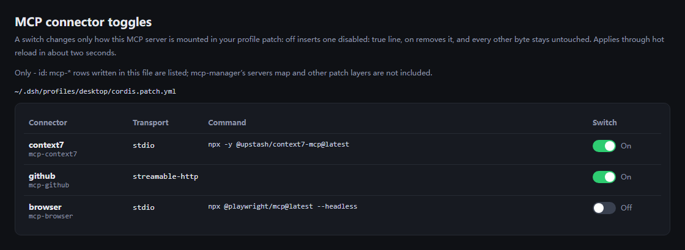

# dsh-mcp-toggles

English | [中文](README.md)

> Flip the MCP servers you already configured on and off from **Settings** in DeepSeek Harness.
> Only that row's `disabled` field changes — the rest of your profile patch stays **byte-for-byte** intact.




> Screenshot of the real page; the data is an example — no local path or credential appears here.

## What it does

Once installed, Settings gains a **MCP connector toggles** page. It lists every
`- id: mcp-*` loader row from the active profile patch, one switch per server.

| Action | What actually happens |
|---|---|
| Turn off | one `disabled: true` line is inserted into that row |
| Turn on | that line is removed again |
| Applies | hot reload in about **2 seconds**; the server's tools leave or rejoin the model's tool list |

Before writing, the current file is copied to `cordis.patch.yml.bak`; the write
goes through a temp file and an atomic rename.

## What it does not do

- It never adds, edits or deletes a server — it only switches rows that exist.
- It ignores `mcp-manager`'s `config.servers` map and patch layers shipped by other bundles.
- It never shows or reads credentials (`env` and `headers` stay out of the page).
- It makes no network requests.

## Will a newly added MCP server show up by itself?

**Yes.** The page re-reads the file on every request — nothing is cached — and
refreshes every 10 seconds while visible, plus when the window regains focus.
Three conditions must hold:

1. the row lives in that **one file** — the active profile's `cordis.patch.yml`;
2. its id starts with `mcp-`;
3. it is a loader row (`name: '@deepseek-ai/dsh-mcp-client'`).

```yaml
# add this to the profile patch and the row appears within seconds
- id: mcp-example
  name: '@deepseek-ai/dsh-mcp-client'
  config:
    transport: stdio
    serverName: example
    command: /path/to/node
    args:
      - /path/to/server.mjs
```

An id without the `mcp-` prefix (for example `- id: example`) is not listed: the
plugin does not guess which rows are MCP servers.

## Install

Requires DeepSeek Harness (verified on **0.2.2-rc.3**; declares `0.2.x`).

**From a directory**

```sh
dsh plugin --profile <profile> add /path/to/dsh-mcp-toggles
```

Or in the UI: **Plugins → Add plugin → pick this directory**.

**From a tarball**

```sh
npm pack
dsh plugin --profile <profile> add ./dsh-mcp-toggles-<version>.tgz
```

Reload the page and the entry is in **Settings**.

## Use

1. Open **Settings → MCP connector toggles**
2. The page shows which file it manages — check it is the profile patch you mean
3. Flip a switch; the page reports that it applies in about two seconds
4. Two seconds later the server's tools appear in (or leave) a new session's tool list

If the Settings entry is missing, open this instead:

```
http://127.0.0.1:<port>/mcp-toggles
```

Same API, same behaviour.

## Security

- All three routes answer loopback only: the socket must be a loopback address
  *and* the `Host` header must name `127.0.0.1`, `localhost` or `[::1]`.
- Every write is backed up to `.bak`, done through a temp file and an atomic
  rename, and queued so double clicks cannot interleave.
- Request bodies are capped at 64 KiB, `application/json` is required, and row
  ids must match `^mcp-[\w-]+$`.
- `env` is never read, so no credential can be returned by the API or the page.
- To undo by hand: delete the `disabled: true` line, or restore the `.bak` file.

## Compatibility and limits

- Meant for the Web / Desktop harness (it uses the `webServer` service and the
  settings slots).
- Group nodes (`name: cordis:group`) are not listed. If a row's `disabled` is a
  `!!js` expression, the switch **refuses** to change it and asks you to edit it
  by hand rather than risk corrupting the file.
- Line endings (CRLF / LF), a UTF-8 BOM and the trailing newline are preserved.

## How it differs from similar plugins

Several MCP management panels already exist, with more features (create, edit,
test connections, per-tool switches). This one is deliberately narrow: **switch
rows you already have, touch nothing else**, so it needs no migration of your
current configuration. If you want to create or edit servers, use one of the
full managers instead.

## Development

```sh
npm test                   # unit tests: patch parsing and HTTP handlers
node scripts/validate.mjs  # manifest, assets, detail docs, package contents
node scripts/privacy-check.mjs
```

No runtime dependencies: `node:` built-ins plus the React already in the page's
module table.

## Releasing (maintainers)

```sh
npm publish --access public
```

`prepack` runs `scripts/validate.mjs` first, so a broken manifest or a missing
asset stops the release.

## License

[MIT](LICENSE)
