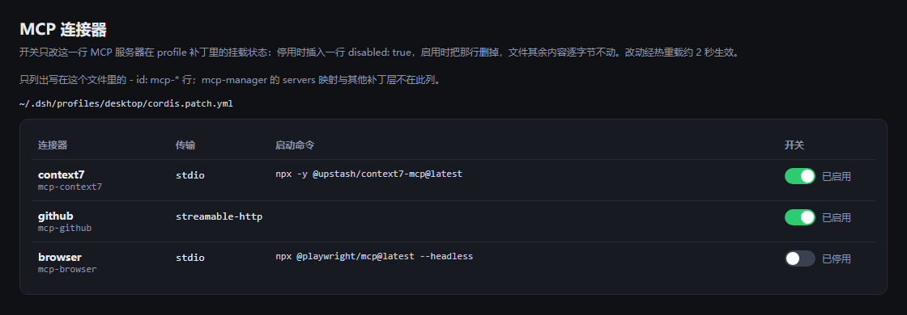

# dsh-mcp-toggles

[English](README.en.md) | 中文

> 在 DeepSeek Harness 的**设置**里，把已经写好的 MCP 服务器一个个开关。
> 它只改那一行的 `disabled`，你的 profile 补丁其余部分**逐字节不动**。




> 界面实拍；数据为示例，不含任何本机路径或凭据。

## 它是什么

装好之后，「设置」里会多出一页 **MCP 连接器**（英文界面是 *MCP connector toggles*），
把当前 profile 补丁里所有 `- id: mcp-*` 的 loader 行列成一张表，每行一个开关。

| 操作 | 实际发生的事 |
|---|---|
| 关掉 | 在该行里插入一行 `disabled: true` |
| 打开 | 把那一行删掉 |
| 生效 | 热重载约 **2 秒**，该服务器的工具随即从模型的工具列表消失 / 回来 |

改动前会把原文件备份成 `cordis.patch.yml.bak`，写入用临时文件 + 原子重命名。

## 它不做什么

- 不新增、不编辑、不删除服务器 —— 只开关你已经有的行
- 不碰 `mcp-manager` 的 `config.servers` 映射，也不碰其他插件 bundle 自带的补丁层
- 不显示、不读取任何凭据（`env`、`headers` 都不会出现在页面上）
- 不发任何网络请求

## 新加的 MCP 会自动出现吗

**会。** 页面每次请求都重新读盘解析，没有缓存；页面可见时每 10 秒、以及窗口回到前台时各刷新一次。
但要同时满足三个条件：

1. 行写在**同一个文件**——当前 profile 的 `cordis.patch.yml`；
2. 行 id 以 `mcp-` 开头；
3. 是 loader 行（`name: '@deepseek-ai/dsh-mcp-client'`）。

```yaml
# 加进 profile 补丁，页面十几秒内就会出现这一条
- id: mcp-example
  name: '@deepseek-ai/dsh-mcp-client'
  config:
    transport: stdio
    serverName: example
    command: /path/to/node
    args:
      - /path/to/server.mjs
```

写成 `- id: example`（不带 `mcp-` 前缀）就不会被识别——插件不靠猜判断哪一行是 MCP。

## 安装

需要已有的 DeepSeek Harness（已在 **0.2.2-rc.3** 上验证，声明兼容 `0.2.x`）。

**方式一：本地目录**

```sh
dsh plugin --profile <profile> add /path/to/dsh-mcp-toggles
```

也可以在图形界面里：**插件 → Add plugin → 选择这个目录**。

**方式二：打包后安装**

```sh
npm pack
dsh plugin --profile <profile> add ./dsh-mcp-toggles-<version>.tgz
```

装完刷新页面，「设置」里就会出现 **MCP 连接器**。

## 使用

1. 打开 **设置 → MCP 连接器**
2. 页面顶部显示它管理的文件路径——确认是你想改的那份 profile 补丁
3. 点任意开关；页面上会提示「约 2 秒生效」
4. 2 秒后新会话的工具列表里，该服务器的工具就应该出现 / 消失

如果设置页没有出现这个入口，可以直接打开：

```
http://127.0.0.1:<DSH 端口>/mcp-toggles
```

这是同一套接口的备用页面，功能一致。

## 安全

- 三条路由只服务本机：socket 必须是回环地址，且 `Host` 必须是 `127.0.0.1` / `localhost` / `[::1]`
- 写前备份 `.bak`，写入是临时文件 + 原子重命名，连点由串行队列排队
- 请求体上限 64 KiB；只接受 `application/json`；行 id 必须匹配 `^mcp-[\w-]+$`
- 不读取 `env`，页面与接口都不会返回凭据
- 想手动回退：删掉那一行 `disabled: true`，或把 `.bak` 复制回去

## 兼容与边界

- 只在 **Web / Desktop** 的 Harness 里有意义（它依赖 `webServer` 与设置页插槽）
- 组节点（`name: cordis:group`）不会出现在列表里；如果某一行的 `disabled` 是 `!!js` 表达式，开关会**拒绝改动**并提示手动处理，而不是冒险改坏文件
- 换行符（CRLF / LF）、UTF-8 BOM、末尾换行都会原样保留

## 和同类插件的区别

社区里已有不少功能更全的 MCP 管理面板（增删改、连接测试、工具级开关）。
这个插件的范围刻意很小：**只开关已有行，其余一个字节都不动**，因此也不需要迁移你现有的配置。
如果你的需求是"新建 / 编辑服务器"，请选功能更完整的管理器。

## 开发

```sh
npm test                   # 单元测试：补丁解析、HTTP 处理器
node scripts/validate.mjs  # 清单、资源、详情文档、打包内容
node scripts/privacy-check.mjs
```

零运行时依赖，`node:` 内置模块 + 浏览器模块表里的 React。

## 发布（维护者）

```sh
npm publish --access public
```

`prepack` 会先跑 `scripts/validate.mjs`，清单或资源有问题时发布会中止。

## 许可

[MIT](LICENSE)
